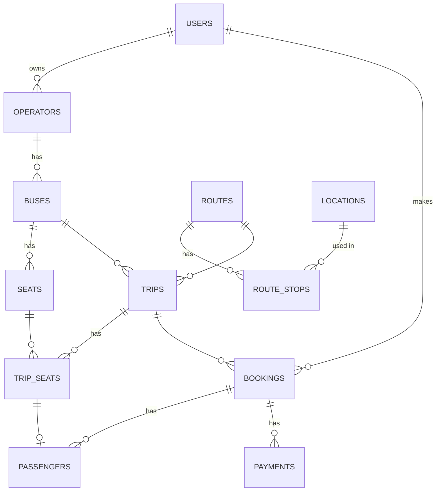

# Step 2 - Database tables

All the models are in [models.py](../app/models.py). SQLite for local dev, should work on Postgres too
by changing `DATABASE_URL` in `.env`.

## ER diagram

## Tables

| Table | What it's for | Important columns / rules |
|---|---|---|
| `users` | everyone who logs in | `email` unique, `role` = customer / operator / admin |
| `operators` | bus companies | `name` unique, `owner_user_id` -> users |
| `buses` | a bus | `registration_number` unique, `bus_type`, `amenities` (JSON list) |
| `seats` | physical seats in a bus (the layout) | unique (`bus_id`, `seat_number`), `position` window/aisle |
| `locations` | bus stands | unique (`name`, `city`) |
| `routes` | e.g. Delhi - Jaipur - Ajmer | `name`, `distance_km` |
| `route_stops` | the stops of a route, in order | `stop_order` (0 = start), `minutes_from_origin` |
| `trips` | a bus running a route at a certain time | `departure_time`, `arrival_time`, `base_fare`, `status` |
| `trip_seats` | **a seat on one specific trip, this is what we sell** | unique (`trip_id`, `seat_id`), `price`, `status` available/held/booked, `booking_id` |
| `bookings` | a customer's booking | `pnr` unique, `status` pending/confirmed/cancelled/expired, `expires_at` |
| `passengers` | one row per seat in a booking | `name`, `age`, `gender`, `trip_seat_id` |
| `payments` | charges and refunds | `idempotency_key` unique, `kind` charge/refund |

## Why `seats` and `trip_seats` are separate

My first idea was to put a `status` column straight on `seats`. That doesn't work because the
same bus does lots of trips, and seat 5 can be free on Monday but booked on Tuesday. So when a trip
is created we copy every seat of the bus into `trip_seats`, and bookings point at those.
Bonus: each trip seat has its own price, so window seats can cost more.

## Other notes

- All times are stored in UTC (naive datetimes). The search converts the user's local date using `LOCAL_TIME_OFFSET_MINUTES`
- Statuses are plain strings. The possible values are listed in a comment at the top of `models.py`
- Payments are never updated after the fact. A refund is a new row with `kind = "refund"`
- Tables get created on startup with `create_all`. Should move to Alembic migrations later
