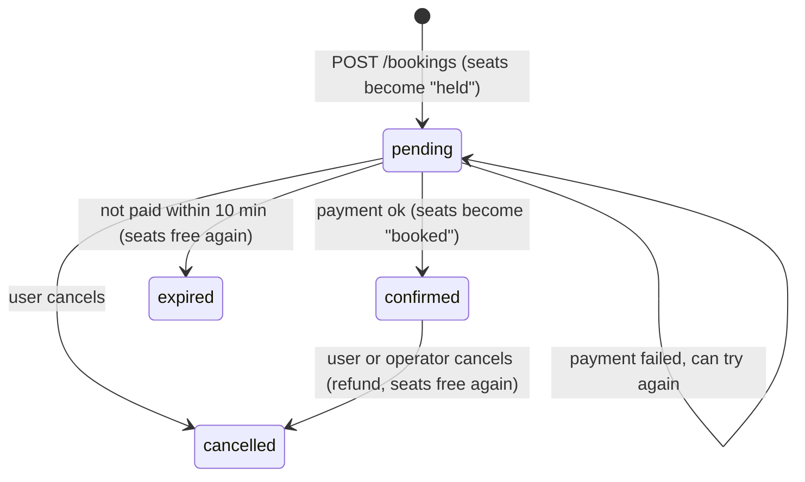

# Step 4 - How booking works (and how we avoid double booking)

## Booking statuses



## Why hold first and pay after?

Paying takes time and can fail. If we only marked the seat as taken after payment, two people
could both pay for the same seat. So we hold the seat for 10 minutes while they pay.

## The double booking problem

The obvious way is:

```python
seat = db.query(TripSeat).get(id)
if seat.status == "available":   # <- two requests can BOTH get past this line
    seat.status = "held"
    db.commit()
```

If two people click "book" at the same moment, both read "available" and both get the seat.

What I did instead (in `routers/bookings.py`) is one UPDATE that only matches seats that are
still available, and then I check how many rows it actually changed:

```python
updated = (
    db.query(TripSeat)
    .filter(TripSeat.id.in_(seat_ids), TripSeat.trip_id == trip.id, TripSeat.status == "available")
    .update({"status": "held", "booking_id": booking.id}, synchronize_session=False)
)
if updated != len(seat_ids):
    db.rollback()
    raise HTTPException(status_code=409, detail="One or more seats are no longer available")
```

The database runs each UPDATE one at a time for the same row. So the second request's UPDATE finds the
seat already `held` and changes 0 rows, and they get a 409. If you book 3 seats and only 2 could be
grabbed, the rollback gives those 2 back. It's all or nothing.

I used the same idea for confirming a payment and for cancelling (`filter(status == "pending").update(...)`),
so a payment and an expiry can't both win at the same moment.

I tested this by sending 10 booking requests for the same seat at the same time to a running server.
Every time, exactly one got `201` and the other nine got `409`.

## Expired holds

Unpaid bookings need their seats back after 10 minutes. Instead of a cron job, there's a
`release_expired_bookings(db)` function in `utils.py`. It's called at the start of every endpoint that
cares about seats (search, seat map, booking, payment...). It marks old pending bookings as `expired`
and sets their seats back to `available`.

Downside: reading the seat map does a write to the DB. Fine for now, but a background job would be cleaner later.

## Payments and retries

- The client sends an `Idempotency-Key` header with each payment attempt
- `payments.idempotency_key` is unique in the DB, so the same key can't be saved twice
- If a key we've already seen comes in, we just return the booking as it is (status 200)
- Refunds are added as new payment rows (`kind = "refund"`), we never edit the original charge
